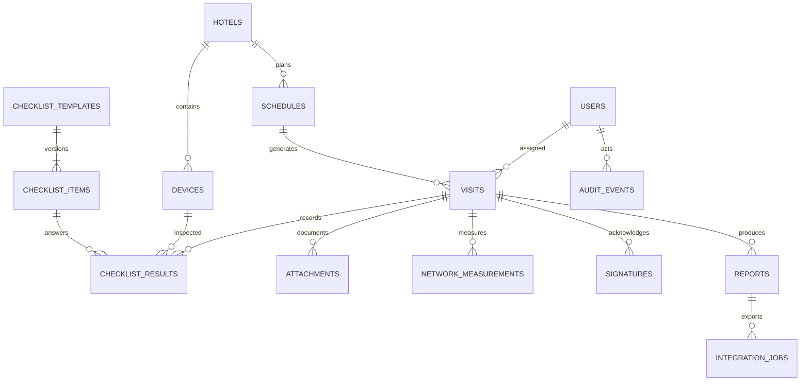

# Rencana implementasi Hotel Network Maintenance

Status terkini: backend/dashboard sampai 0009_site_report_profile telah diuji dan
diterapkan. Kunjungan hotel, foto wajib privat, hasil router/switch, sampling AP,
FO/wireless, laporan manual dan revisi/approval tersedia di samping alur lama.
Speedtest browser otomatis tersedia dalam mode diagnostik; mode AP lapangan
menunggu HTTPS langsung. APK, offline, analyzer/speedtest native, tanda tangan dan PDF masih merupakan
target. Rincian implementasi aktual: HOTEL_VISITS.md; arsitektur berikut mencakup
target yang belum seluruhnya tersedia. Tidak ada seed produksi.

## Alur dan hak akses

Supervisor mengelola hotel, inventaris, template checklist, jadwal bulanan,
penugasan, dan persetujuan laporan. Teknisi melihat penugasannya sendiri,
melakukan kunjungan, mengisi checklist, serta mengirim laporan.
Server wajib memeriksa hak akses pada setiap operasi dan objek.

Status kunjungan: assigned → in_progress → submitted → approved.
Supervisor dapat mengubah submitted → revision_requested dengan alasan;
teknisi memperbaiki lalu mengirim ulang. Pembatalan sebelum persetujuan
memerlukan alasan. Laporan approved tidak dapat diedit; koreksi dibuat sebagai
revisi baru dengan riwayat tetap tersimpan.

Check-in menyimpan waktu perangkat, waktu diterima server, koordinat dan akurasi.
Check-out dilakukan setelah checklist wajib, bukti foto sesuai template, dan
tanda tangan PIC lengkap. GPS tidak tersedia atau PIC tidak bisa tanda tangan
harus dicatat sebagai pengecualian dengan alasan untuk ditinjau supervisor.
Tidak boleh mengarang koordinat atau hasil pengukuran.

## Arsitektur

- Android: React + Capacitor; plugin Kotlin untuk pemindaian Wi-Fi.
- Database lokal perangkat menyimpan penugasan, template, jawaban, dan outbox;
  foto disimpan sebagai file lokal sampai server mengonfirmasi penerimaan.
- FastAPI menjadi sumber data utama dan pemeriksa izin serta transisi status.
- PostgreSQL menyimpan data transaksi; storage privat menyimpan bukti dan PDF.
- Worker terpisah memproses PDF dan sinkronisasi Google melalui job persisten.
- Reverse proxy HTTPS meneruskan trafik ke API localhost. Database tetap privat.
- Akses keluar Google/LibreSpeed perlu network tambahan pada layanan terkait;
  jangan membuka port PostgreSQL atau menghapus isolasi database.

## ERD konseptual

Relasi berikut merupakan target, bukan schema yang telah diterapkan.

Data minimum untuk migrasi berikutnya:

| Entitas | Data dan batasan utama |
|---|---|
| users | UUID, identitas login unik, password hash, role, status aktif; tanpa password bawaan |
| hotels | nama, alamat, timezone IANA, kontak PIC, koordinat opsional |
| devices | hotel, jenis, nama, merek/model, serial, IP/MAC, lokasi, status; tanpa kredensial perangkat |
| schedules | hotel, periode lokal bulanan, template version, teknisi, jatuh tempo; unik hotel/periode untuk jadwal bulanan standar |
| visits | jadwal, teknisi, status, waktu dan GPS check-in/out, accuracy, version untuk konflik |
| checklist_templates/items | versi immutable saat sudah digunakan, tipe perangkat, urutan, jenis jawaban, wajib/bukti wajib |
| checklist_results | visit, device, item version, jawaban, catatan/tindakan; unik visit/device/item |
| attachments | visit, object key privat, MIME tervalidasi, ukuran, checksum, pengunggah |
| network_measurements | visit, device opsional, titik ukur, waktu, jenis uji, hasil, unit, sumber, alasan gagal |
| signatures | visit, nama/jabatan PIC, waktu, attachment, pernyataan persetujuan |
| reports | visit, nomor/versi unik, snapshot, keputusan reviewer, PDF key/checksum |
| integration_jobs | report version, target, status, percobaan, retry_at, external ID, error yang sudah disanitasi |
| audit_events | aktor, objek, aksi, waktu server, perubahan relevan tanpa secret |

UUID boleh dibuat klien agar bisa offline; server tetap memeriksa kepemilikan
dan referensi. Waktu transaksi disimpan UTC. Hotel memakai timezone lokal untuk
jadwal. Gunakan foreign key, index referensi/pencarian, dan constraint status.
Data yang sudah dirujuk laporan diarsipkan, bukan dihapus permanen.

## Kontrak offline dan integrasi

1. Login awal dan unduh penugasan memerlukan internet. Kredensial/token disimpan
   di penyimpanan aman Android, bukan localStorage. Server tetap memvalidasi
   status akun ketika sinkronisasi.
2. Setiap mutasi memiliki operation UUID/idempotency key, user, payload hash,
   dan expected version. Retry identik mengembalikan hasil semula; key sama
   dengan payload berbeda ditolak. Perubahan data dan rekaman operasi atomik.
3. Konflik version menghasilkan 409 dan pilihan penyelesaian yang terlihat;
   jangan menimpa jawaban secara diam-diam. Sinkronisasi menarik perubahan
   dengan cursor server, termasuk penanda arsip/penghapusan.
4. Unggahan file dapat diulang tanpa duplikasi; cek checksum dan otorisasi.
   Pengajuan laporan menunggu seluruh bukti wajib berhasil diterima.
5. Outbox bertahan setelah restart. UI menunjukkan pending, syncing, failed,
   synced; retry memakai backoff. Kegagalan Google tidak membatalkan laporan.
6. Job Google dibuat setelah approval dalam transaksi yang sama. Gunakan kunci
   report ID/version untuk mencegah baris Sheets dan file Drive ganda.

## Pengukuran dan bukti

- Wi-Fi: SSID, BSSID, RSSI dBm, frekuensi MHz, channel, waktu scan dan sumber.
  Simpan status izin ditolak/tidak didukung/hasil lama secara eksplisit.
  Verifikasi izin dan pembatasan scan pada versi Android target melalui HP fisik.
- Speedtest: endpoint/server, download/upload Mbps, latency ms, waktu, tipe
  jaringan, dan status gagal. Tandai jenis koneksi agar hasil seluler tidak
  dilaporkan sebagai pengujian Wi-Fi hotel.
- Ambang kelulusan ditetapkan per hotel/template; belum ada angka standar yang
  disetujui. Tampilkan hasil mentah sebelum kriteria ditentukan.
- Foto/tanda tangan privat, batas ukuran dan MIME diperiksa server; akses
  berdasarkan penugasan atau supervisor. PDF mengambil snapshot versi laporan.

## Tahapan dan kriteria selesai

| Tahap | Hasil | Verifikasi wajib |
|---|---|---|
| 1 | Login, role, CRUD hotel/perangkat, migrasi | login gagal/berhasil, akses lintas penugasan ditolak, constraint pada PostgreSQL uji |
| 2 | Jadwal, penugasan, template dan transisi kunjungan | jadwal tidak ganda, transisi ilegal ditolak, checklist lama tetap konsisten setelah template berubah |
| 3 | Android, offline, checklist, foto, GPS, tanda tangan | airplane mode → restart → online tanpa data hilang/ganda; konflik dan upload terputus tertangani |
| 4 | Wi-Fi dan LibreSpeed | uji HP fisik, izin ditolak, scan terbatas, koneksi putus dan jenis jaringan tercatat |
| 5 | Approval, PDF, Drive/Sheets | revisi terlacak, PDF sesuai snapshot, retry Google tanpa duplikasi |
| 6 | Operasional | HTTPS, backup/restore teruji, monitoring, migrasi dan prosedur pemulihan teruji |

## Data nyata yang dibutuhkan sebelum onboarding

Nama hotel, alamat/timezone, PIC, inventaris dan lokasi perangkat; daftar
teknisi/supervisor; template dan kewajiban bukti; jadwal kunjungan; endpoint
LibreSpeed; domain; pemilik folder Drive/Sheets dan kredensial integrasi melalui
secret environment. Kebijakan retensi, masa sesi/offline, radius GPS bila
diperlukan, serta target backup/pemulihan harus ditentukan sebelum produksi.

Jangan memasukkan data fiktif ke produksi. Akun pertama dibuat melalui perintah
administratif satu kali dengan input password aman setelah fitur auth tersedia.

Laporan utama terbaru dan profil site/aturan kesesuaian ada di REPORT_FORM.md.
Konfigurasi persentase/bandwidth ditentukan operator per site, bukan angka default.
